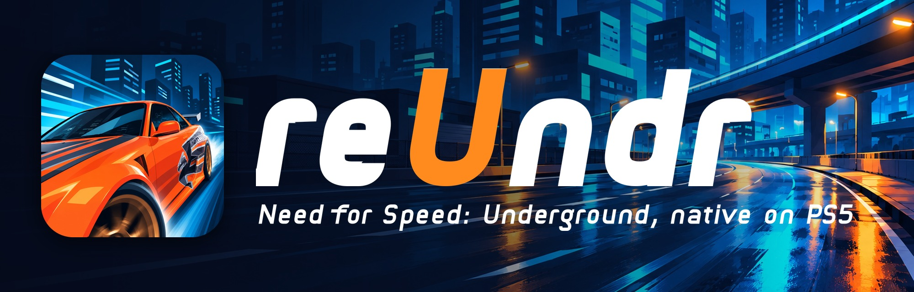
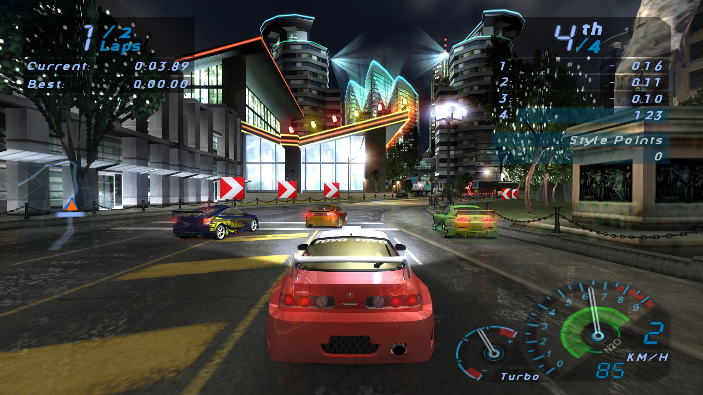
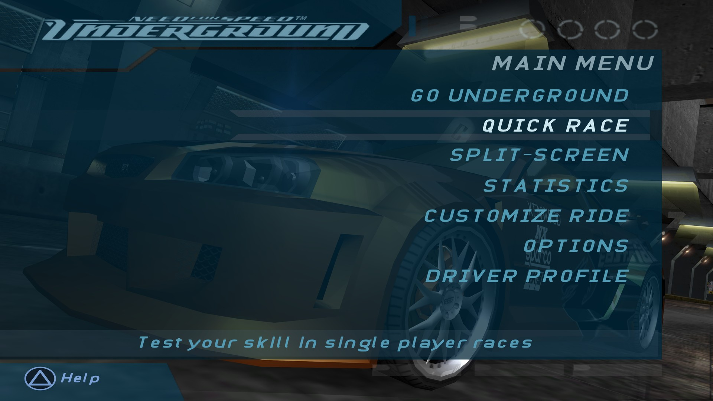
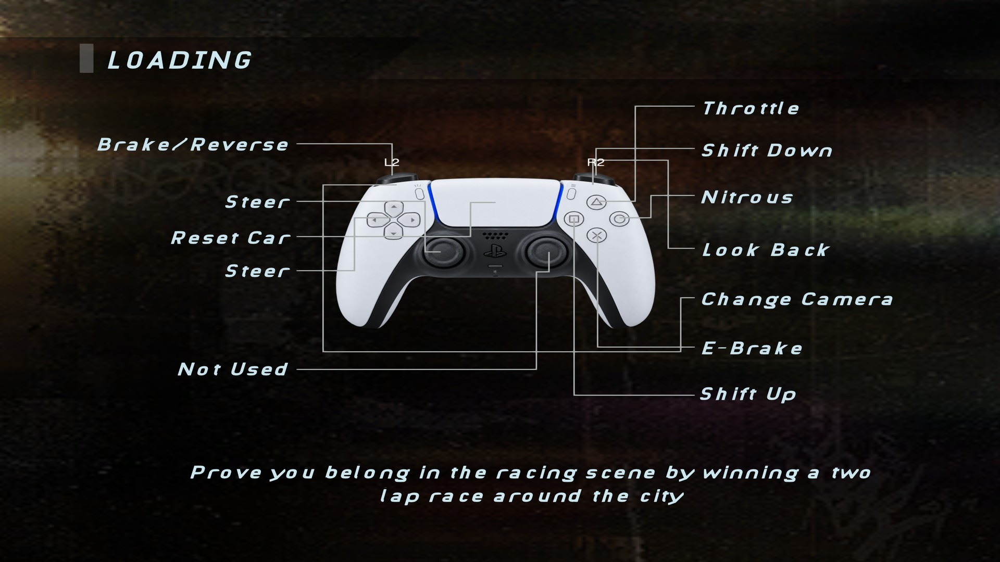
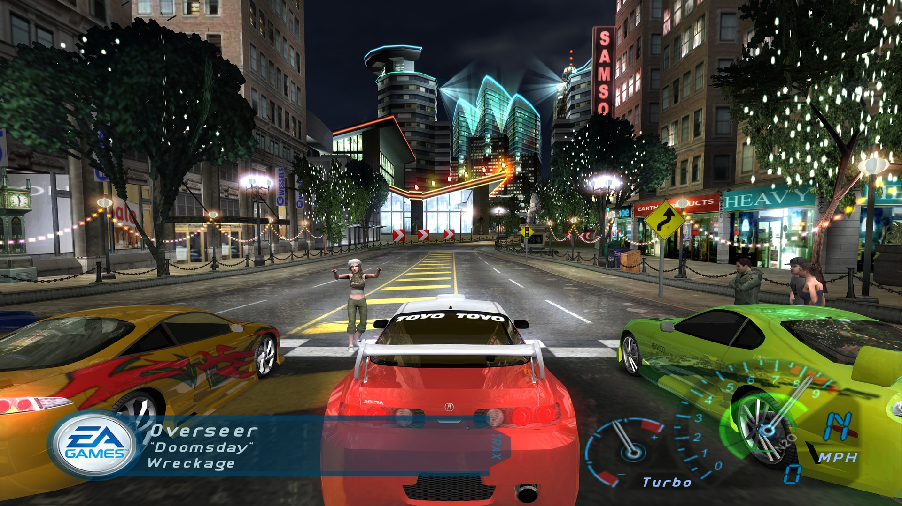
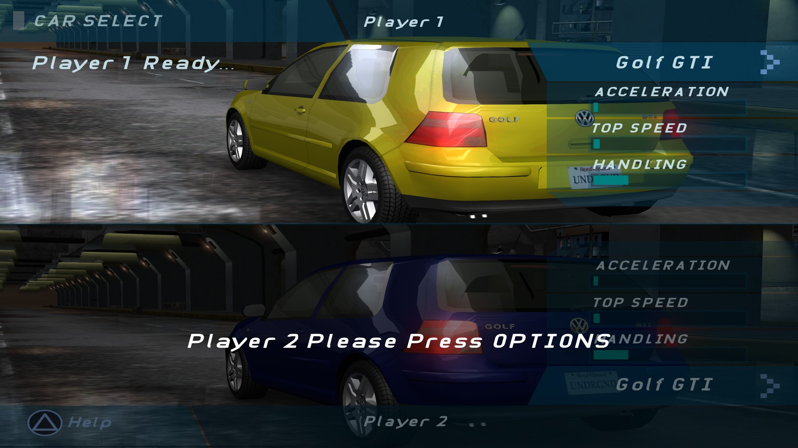
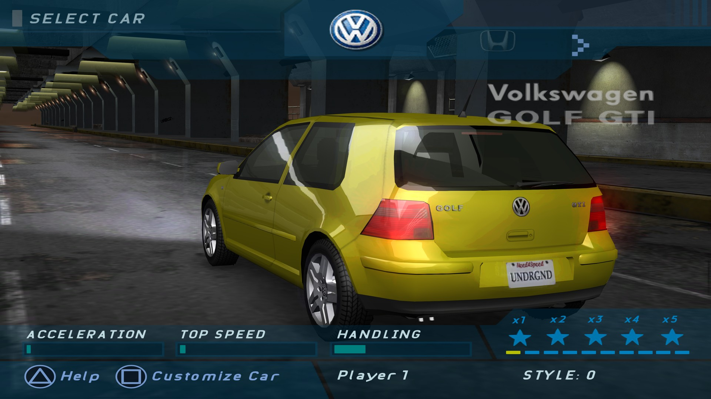
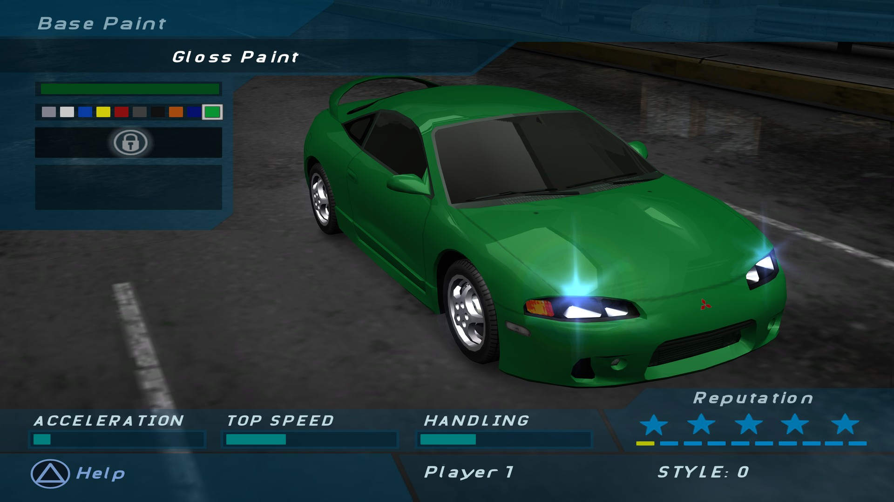
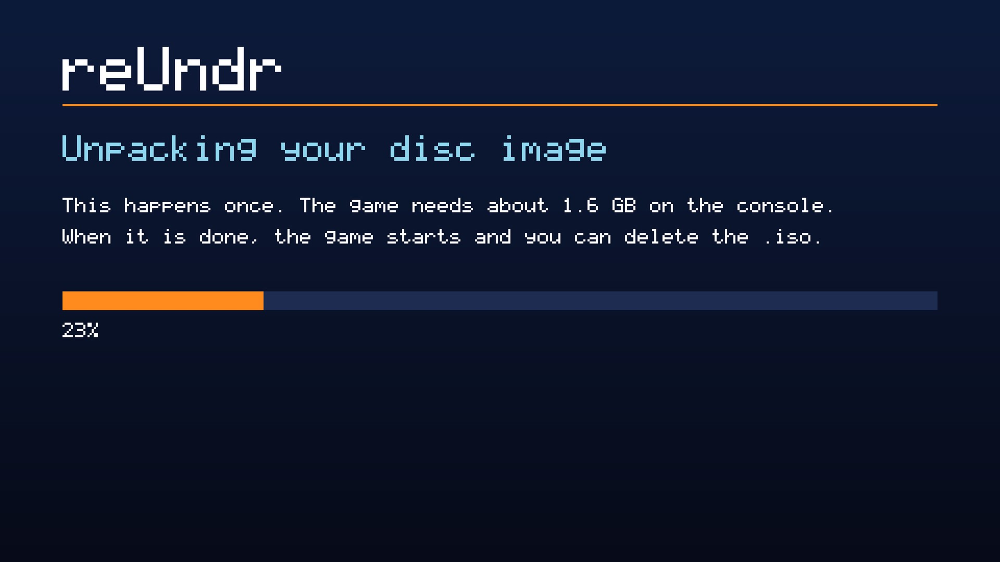

<p align="center">
  
</p>

<p align="center">
  <b>Need for Speed: Underground, the original Xbox version, statically recompiled<br>
  into a native app for homebrew-enabled PS5 consoles.<br>
  Not an emulator. Bring your own disc.</b>
</p>

<p align="center">
  <a href="#install"><b>Install</b></a>
  &nbsp;·&nbsp;
  <a href="#controls">Controls</a>
  &nbsp;·&nbsp;
  <a href="#settings">Settings</a>
  &nbsp;·&nbsp;
  <a href="#reporting-a-bug">Report a bug</a>
</p>

<p align="center">
  
  <br>
  <sub>A race on the PS5, rendered at 3840x2160.</sub>
</p>

> [!IMPORTANT]
> **reUndr is an unofficial fan project.** It is based on
> [antoxa2584x/nfsu1-sw](https://github.com/antoxa2584x/nfsu1-sw), the Nintendo Switch port, and
> is not made by its author. It is not affiliated with, endorsed by or sponsored by Electronic
> Arts Inc., Microsoft or Sony Interactive Entertainment.
>
> **No game files are included or distributed.** To play, you need your own legally obtained
> backup of your own Xbox disc of *Need for Speed: Underground*, USA version. Please don't ask
> for, or share, game files or disc images.

## What it is

The Xbox game's own code, translated into C ahead of time and compiled for the PS5, with a runtime
that stands in for the console. The app holds nothing from the game: it plays the files of your own
disc and leaves them as they are.

## Highlights

- **Native 4K.** Rendering and output at 3840x2160, up to 60 fps.
- **HD text.** Every font is redrawn: the Conduit faces stroke by stroke with square ends, as on the
  disc but sharp at 4K, and Arial as Liberation Sans.
- **DualSense throughout.** Cross, Circle, Square and Triangle in the prompts, PlayStation wording
  in the text, and a DualSense diagram on the loading screens.
- **Two players.** Split screen on one console with two DualSense controllers.
- **Disc image install.** Copy your `.iso` to the console and start the app, it does the rest.
- **Optional HD logos and icons,** made on your computer from your own disc.

<table>
  <tr>
    <td width="50%"><br><sub>The main menu.</sub></td>
    <td width="50%"><br><sub>A loading screen.</sub></td>
  </tr>
  <tr>
    <td width="50%"><br><sub>The start of a race.</sub></td>
    <td width="50%"><br><sub>Split screen.</sub></td>
  </tr>
  <tr>
    <td width="50%"><br><sub>Car selection.</sub></td>
    <td width="50%"><br><sub>Customize Ride.</sub></td>
  </tr>
</table>

<sub>Screenshots: reUndr on a PS5, scaled to 1920x1080; otherwise unedited. With the optional HD
pack, which sharpens the logos and icons. The game content in them belongs to its owners.</sub>

## Requirements

- A **PS5 that runs homebrew**, with [ShadowMountPlus](https://github.com/drakmor/ShadowMountPlus)
  and an FTP server.
- Your own **USA (NTSC-U) Xbox disc** of *Need for Speed: Underground*, backed up by you as a disc
  image (`.iso`) or as files. Its `default.xbe` has SHA-256
  `cdd562ffcc70906b3fecd841db4dc10fd463664b05e03f896a8fb38b9a7d878a`. Recompiled code fits one
  executable, so another release is refused.
- About **1.6 GB free** on the console.

## Install

1. **The app.** Download `PPSA99025-<version>.zip` from
   [Releases](../../releases/latest), unpack it, and copy the `PPSA99025` folder to
   `/data/homebrew/` on the console. The **reUndr** tile appears on the home screen.
2. **Your disc.** Copy your disc image to `/data/nfsu1/` on the console, or to the top of a USB
   drive or its `nfsu1` folder. A trimmed image and a full dump both work.
3. **Play.** Start the tile. The first start unpacks the image to `/data/nfsu1/game`, and then the
   game starts. After that you can delete the `.iso`.

<p align="center"></p>

If the disc is missing or is another release, the app says so on screen and tells you where
things go.

**Already have the files?** Copy them to `/data/nfsu1/game`, or to `nfsu1/game` on a USB drive
(`/mnt/usb0/nfsu1/game` to `/mnt/usb7/nfsu1/game`), so that `default.xbe` sits next to `CARS`,
`TRACKS`, `FRONTEND`, `GLOBAL`, `SOUND`, `MOVIES`, `LANGUAGES` and `MEMCARD`.

**To update,** copy the new `PPSA99025` folder over the old one. Your saves, settings and game files
in `/data/nfsu1/` are kept.

### HD logos and icons (optional)

The app already has HD fonts, PlayStation prompts and PlayStation wording. The logos, car badges
and arrows are textures of the game, so they can't ship here. This makes them, on your computer and
from your own disc, in about a minute:

```sh
python3 -m pip install -r tools/requirements.txt
python3 tools/prepare-disc.py --game <your disc.iso> --out <folder>
```

It needs a copy of this repository, plus `potrace` and `cairo` (`brew install potrace cairo` on a
Mac). Copy `<folder>/nfsu1/hd` to `/data/nfsu1/hd`, or to `nfsu1/hd` on the USB drive that holds
the game.

## Controls

The game plays with its own Xbox controls, matched by position on the DualSense.

| Xbox | DualSense |
|---|---|
| A / B / X / Y | Cross / Circle / Square / Triangle |
| Black / White | R1 / L1 |
| Right / left trigger | R2 / L2 |
| Start | Options |
| Back | Touchpad click |
| Stick clicks | L3 / R3 |

**Second player:** sign in a second local user on the PS5; a guest will do. Assist mode, which
merges two controllers into one, doesn't add a player.

## Settings

Options → Camera has render scale, FXAA, filtering and reflections, and what you save there wins
over the file below.

`/data/nfsu1/PPSA99025/nfsu1_env.txt` is optional and holds `KEY=VALUE` lines read at start:

| Key | Default | Meaning |
|---|---|---|
| `NFSU1_OUTPUT_HEIGHT` | 2160 | output height: 1080, 1440 or 2160 |
| `RECOMP_GL_SCALE` | 4.5 | render scale; 4.5 is 4K, 2.25 is 1080p |
| `NFSU2_FPS_CAP` | 60 | 30 brings back the game's own limit |
| `RECOMP_VK_ANISO` | 16 | anisotropic filtering |
| `RECOMP_VK_FXAA` | 1 | FXAA |
| `RECOMP_AUDIO_VOLUME` | | volume |
| `RECOMP_FPS_LOG` | 0 | fps in the log every 10 seconds |
| `NFSU1_HD` | 1 | 0 turns the HD textures off, and the PlayStation prompts with them |

## Your files

Everything reUndr writes is in `/data/nfsu1/PPSA99025/`: saves, settings, shader caches and logs.
The app folder holds only the program, its artwork and its licences.

## Reporting a bug

Open an [issue](../../issues), say what you were doing, what you expected and what happened, and
attach `/data/nfsu1/PPSA99025/stderr.log` from the console. **Never attach game files or disc
images.**

## For developers

Build on macOS with Python 3, LLVM 18, CMake, Ninja, Meson, nasm and Docker. The game's C code is
made from your own disc, unpacked to `source/Need For Speed Underground`:

```sh
python3 -m venv .venv
.venv/bin/pip install capstone numpy 'pillow>=13' cairosvg etcpak==0.9.15 texture2ddecoder==1.0.6
brew install potrace cairo meson nasm dav1d ffmpeg
.venv/bin/python tools/prepare.py                      # upstream, and C from the Xbox disc
python3 tools/rebuild-deps.py                          # pinned dependencies
bash tools/build.sh                                    # compile and link
python3 tools/test.py                                  # tests under ASan and UBSan
.venv/bin/python tools/build-ps5-ui.py                 # the app's wording table
.venv/bin/python tools/build-hd-ui.py --own --no-imagegen --out build/hd-own
.venv/bin/python tools/package.py --release
```

Exact revisions are in `ps5/dependencies.json`, changes to upstream in `ps5/upstream.patch`. The
public package is checked against a list of allowed files, and the HD art in it is drawn from
vectors, strokes and Liberation Sans, with nothing taken from the disc's pixels.

## Credits

- **[antoxa2584x/nfsu1-sw](https://github.com/antoxa2584x/nfsu1-sw)** is the recompilation this port
  is built on.
- **[xboxrecomp](https://github.com/sp00nznet/xboxrecomp)** is its Xbox runtime.
- [PS5_Vulkan](https://github.com/mihawk-99/PS5_Vulkan),
  [PS5_Mesa](https://github.com/mihawk-99/PS5_Mesa) (RADV) and
  [PS5_PayloadSDK](https://github.com/mihawk-99/PS5_PayloadSDK) by mihawk-99, SDL3, and the rest in
  `NOTICE.md`.
- PS5 port: [bystritskiy](https://github.com/bystritskiy).

Problems with the PS5 build belong here, not upstream.

## License

The PS5 host and the tools are MIT ([LICENSE](LICENSE)). The vendored runtime includes MIT and
LGPL-2.1-or-later components, and the PS5 executable links GPL-3.0-or-later parts of PS5_Vulkan and
PayloadSDK, so the built app as a whole is under those terms; see [NOTICE.md](NOTICE.md). The game,
its assets and the code generated from it belong to their owners and aren't covered by any licence
here.

## Legal notice

This is a non-commercial fan project with no connection to the rights holders. "Need for Speed" and
"Underground" are trademarks of Electronic Arts Inc. Xbox is a trademark of Microsoft Corporation.
PlayStation, PS5 and DualSense are trademarks of Sony Interactive Entertainment Inc. All other
trademarks belong to their respective owners.
